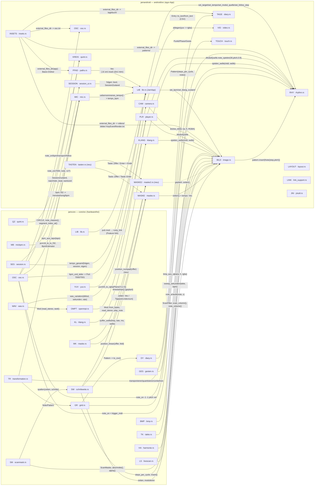
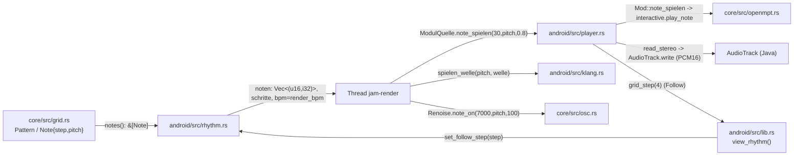
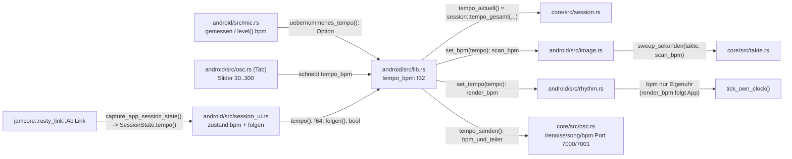
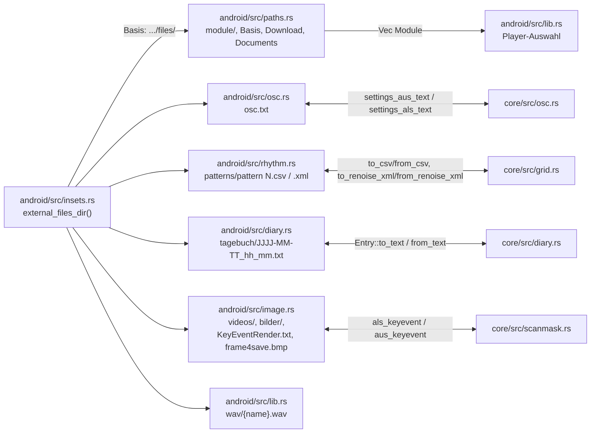

# JamCore: Werte-Flüsse zwischen den Dateien (API/Pipeline)

Stand: 2026-10-14 · **nur lesend erhoben** (Arbeitsbaum, keine Quelländerung) ·
Bezug: `docs/funktionen-android-app.md`, `docs/plans/2026-10-14-menues-und-klang.md`.

Hinweise zum Stand:

- `android/src/maske2.rs` und `android/src/tasten.rs` sind **neu / in Arbeit** und im
  Arbeitsbaum noch **nicht in `android/src/lib.rs` eingebunden** (dort fehlen
  `mod maske2;`/`mod tasten;`, `android/src/lib.rs:1-21`). `android/src/maske.rs`
  ruft außerdem `self.feld_anschlagen(...)` (`android/src/maske.rs:462,500`), das
  im Baum nicht definiert ist — die Nummernblock-/M2-Kette ist als „geplant" markiert.
- „Ein BPM" (Plan Step 4) ist noch nicht umgesetzt: es gibt weiterhin die vier
  getrennten Werte `tempo_bpm`, `scan_bpm`, `render_bpm`, `bpm` (Abschnitt c).

## 1. Überblick: ein Knoten je Datei

Kürzel: SW = schrittweite, GR = grid, SM = scanmask, MK = maske (Kern),
OSC = osc, SES = session, MB = micbpm, TK = takte, LS = livescan, HA = harmonie,
KL = klang, OMPT = openmpt, TR = transformation, DY = diary, WAV/BMP/YUV = Datei-IO,
QZ = quint, GES = gesten. Android-Seite: BILD, RHY, PLR, KLANG, MIC, MASKE,
MASKE2, TASTEN, KREIS, SESSION, TAGE, PFAD, INSETS, CAM, VID, TOUCH, LAYOUT,
LINK, JNI.

## 2. Je Datei: kommt rein / geht raus

### Crate `jamcore` (core/src)

| Datei | kommt rein (von wem) | geht raus (an wen) |
|---|---|---|
| `lib.rs` | — (Modul-Liste) | Modulpfade `jamcore::*` an alle; `rusty_link` an android/lib.rs (Feature `link`) |
| `schrittweite.rs` | `Tipp{zeit,indexnum}` (aus maske.rs/maske2.rs), `regeln` (Abschnitt min/max), Tempo-Profil | `timestamps(_mit_regeln) -> Vec<f32>` an android/lib.rs (maske_bereich), `spalten() -> Vec<usize>` an scanmask.rs, `modulieren()` an image.rs |
| `grid.rs` | Zeitstempel/CSV/XML-Text (Dateien), Noten von image.rs/rhythm.rs | `Pattern{steps_per_cycle, notes: Vec<Note>}` an rhythm.rs/image.rs/diary.rs; `Note{step,instrument,pitch,glide}` an transformation.rs; CSV/XML an Dateien |
| `scanmask.rs` | `zeiten: &[f32]` (aus_zeiten), `KeyEventRender.txt`-Text, Klicks (setze) | `ScanMaske.abschnitte()/alpha()` an image.rs; `als_keyevent()` an Datei |
| `maske.rs` | Ziffern 0–9 + Feldgröße, Wischproben | `position_linear()/position_numpad() -> Option<usize>` an android/maske.rs und maske2.rs; `Verteilung` an transformation/Recorder-Port |
| `osc.rs` | Host/Port (osc.txt), Adresse+Args, Teiler | OSC-Bytes (UDP) an Renoise/bundle_udp; `settings_aus_text/als_text` an android/osc.rs; `bpm_und_teiler` an android/lib.rs |
| `session.rs` | `folgen: bool`, `session_bpm: f64`, `eigenes_bpm: f32`, `beat/quantum` | `tempo_gesamt() -> f32` an android/lib.rs (tempo_aktuell); `naechster_beat()/wartezeit_bis_beat()` an session_ui.rs |
| `micbpm.rs` | PCM16-LE-Bytes (`&[i8]`) aus android/mic.rs | `BpmEstimator.estimate() -> (bpm, konfidenz)`, `pcm16_le_to_f32()`, `fold_bpm()` |
| `takte.rs` | `takte: f64` (Fader), `bpm: f64` (App-Tempo) | `sweep_sekunden() -> f64` an image.rs; `teile/vielfache/text` an UI |
| `livescan.rs` | RGBA-Frame + Spalte + `ScanFilter{bg,sel,range}` | `scan_column() -> Vec<(y,r,g,b)>` an image.rs; `note_volume(_farbe) -> (note, vol)`; `spalte_im_bereich() -> i32` |
| `harmonie.rs` | Klicks im Bild (Bandgrenze x), Notenklassen aus dem Kreis | `note_erlaubt(note, x) -> bool` an image.rs; `baender()` an UI |
| `klang.rs` | `midi: i32`, `Welle`, Rate/Länge | `frequenz() -> f32`, `puffer_welle() -> Vec<i16>` an android/klang.rs |
| `openmpt.rs` | Modulbytes (`Vec<u8>`), `instrument/note/volume` | `Mod{ptr}` mit `read_stereo()`, `play_note`, Metadaten, `sample_name()` an player.rs; an wav.rs (`Mod`) |
| `transformation.rs` | `&[Note]`/`Pattern`, Halbtöne, Taps (`&[f64]`) | neue `Vec<Note>` an rhythm.rs; `bpm_aus_taps() -> Option<f32>` an mic.rs; Skalen an rhythm.rs |
| `diary.rs` | `zeit: u64`, Name/Notiz/BPM, `Pattern` | `Entry::to_text() -> String` an Datei; `from_text()` liest Datei (android/diary.rs) |
| `wav.rs` | `&Mod`, `sekunden`, `rate` | `wav_variation() -> Vec<u8>` (WAV) an player.rs (Datei `wav/`) |
| `bmp.rs` | `breite, hoehe, rgba` | `bmp_aus_rgba() -> Vec<u8>` (BMP) an image.rs (Datei `frame4save.bmp`) |
| `yuv.rs` | drei `Plane{data,row_stride,pixel_stride}` + Maße | RGBA-Bytes an camera.rs (Framepuffer) |
| `quint.rs` | Auswahl `&[usize]`, Touchpunkt (rx, ry), Radien | `CIRCLE`, `segment_index_at()`, `note_classes()` an android/quint.rs |
| `gesten.rs` | `(id, Phase, Punkt)` je Frame | `Geste{zoom, pan}` an touch.rs |

### Crate `jamandroid` (android/src)

| Datei | kommt rein (von wem) | geht raus (an wen) |
|---|---|---|
| `lib.rs` | `tempo_bpm` (OSC-Tab/Mic), `SessionZustand`+`folgen` (session_ui), Mac-Panel-Zustände, `Vec<PathBuf>` Module | `tempo_aktuell()` an image/rhythm/diary/OSC-Sender; `set_target`, `set_tempo`, `set_bpm`, `set_modul_quelle`, `set_follow_step` an Panels; `tempo_senden()` an core/osc |
| `image.rs` | Kamera/Video-RGBA (camera.rs), `zeiten`+`tempo` (lib.rs maske_bereich), `Pattern` (steps_per_cycle), `Klangquelle/Welle/ModulQuelle` (rhythm.rs), Farbwähler/Bereich/Maske/Harmonie | OSC `note_on`+`trigger_midi` (core/osc), `Note{step,pitch}` ins `Pattern` (grid), `ScanMaske` an Leiste; KeyEventRender.txt/frame4save.bmp |
| `rhythm.rs` | `Pattern` (8 Slots), `target` (host/port), `render_bpm` von lib.rs, `ModulQuelle` von player.rs, Klangwahl | OSC `note_on`/Transport (core/osc), `spielen_welle` (klang), `ModulQuelle.note_spielen`; CSV/XML nach `patterns/` |
| `player.rs` | Modulpfad, `looping`, Samplerate; Note-Wünsche von rhythm/image | PCM16 an `AudioTrack` (Java); `ModulQuelle` an rhythm.rs/image.rs; WAV nach `wav/`; `grid_step()` an lib.rs (Follow) |
| `klang.rs` | `(midi, Welle)` über Kanal (rhythm/image) | PCM16 an `AudioTrack`; nutzt `puffer_welle`/`frequenz` aus core/klang |
| `mic.rs` | AudioRecord-Bytes (PCM16 mono); Ziel host/port von lib.rs | `Level{peak,bpm,konfidenz}` an UI; `uebernommenes_tempo()` an lib.rs; `bpm` per OSC an Renoise |
| `osc.rs` | Host/Port-Felder, Knopfaktionen, `osc.txt` | OSC-Aufrufe über core/osc (note/start/stop/bpm/follow/raw) |
| `maske.rs` | Touchgesten (`Mehrfinger`), Ziffern (tasten.rs, geplant), min/max-Regler | `Aufzeichnung{zeit,indexnum,tempo}` intern; `zeiten() -> Vec<f32>` an lib.rs; aktuell Baufehler: `feld_anschlagen()` fehlt |
| `maske2.rs` | Touch auf 10er-Numpad, Ziffern/Enter (tasten.rs), „Ende"/„neu" | `zeiten() -> Vec<f32>` (noch nicht an lib.rs angebunden); Werte [7,8,9,4,5,6,1,2,3,0] |
| `tasten.rs` | `egui::Event::Key` (`Num0..Num9`, `Enter`) | `Vec<Taste>` (`Ziffer(u8)`, `Enter`) an maske.rs/maske2.rs (noch nicht in lib.rs deklariert) |
| `quint.rs` | Touchposition, Ziel host/port | `note_on` direkt (core/osc); `Vec<i32>` Notenklassen an lib.rs → `bild.harmonie_band()` |
| `session_ui.rs` | `SessionZustand{...}` von lib.rs (Link) | `folgen: bool`, Quantum an lib.rs; Aktionen `LinkUmschalten/LinkNeustart` |
| `diary.rs` | BPM (`Option<f32>`) + `Pattern` von lib.rs | Textdatei `tagebuch/JJJJ-MM-TT_hh_mm.txt` (core/diary-Format); liest Ordner beim Start |
| `paths.rs` | `external_files_dir` (insets) | `Vec<PathBuf>` Module an lib.rs |
| `insets.rs` | JNI/Activity (WindowInsets, Resources, `getExternalFilesDir`) | `(top,bottom)` px an lib.rs; Basisordner-String an paths/image/rhythm/diary/osc |
| `camera.rs` | CameraBridge-Frames (YUV_420_888), Standbilder | RGBA-Framepuffer an image.rs (`letztes_bild`); `ablegen()` an video.rs |
| `video.rs` | VideoBridge-Frames, Pfad+fps von image.rs | RGBA über `camera::ablegen` an image.rs |
| `touch.rs` | `egui::Event::Touch` | `Rahmen{geste,starts,zuege,endes}` an maske.rs/image.rs; füttert core/gesten |
| `layout.rs` | `KombiTeil`-Wahl, verfügbare Maße | Layout (Stapel/nebeneinander) für lib.rs `teil_ui()` |
| `link_support.rs` | `AndroidApp` (JNI) | `acquire()/release()` MulticastLock über LinkSupport.java |
| `jniutil.rs` | Activity + JNIEnv | Helfer `with_env`, `call_object*`, `jstring`, `clear` an camera/video/insets/mic/player/klang/link_support |

## 3. Pipeline a) Aufnahme: Maske 2/Maske → Zeitpunkte → Bild → Sweep

```mermaid
flowchart LR
  M1["android/src/maske.rs<br/>Aufzeichnung{zeit,indexnum,tempo}"] -->|"als_tipp() -> Tipp{zeit,indexnum}"| SW["core/src/schrittweite.rs<br/>timestamps_mit_regeln(tipps, regeln)"]
  T["android/src/tasten.rs (neu)<br/>Taste::Ziffer/Enter"] -.->|"position_numpad/linear"| M2["android/src/maske2.rs (neu)<br/>Aufzeichnung{zeit,indexnum,tempo=[]}"]
  M2 -.->|"geplant: zeiten()"| SW
  SW -->|"zeiten: Vec<f32>"| LIB["android/src/lib.rs<br/>maske_bereich()"]
  LIB -->|"maske_aus_zeiten(zeiten, tempo, staerke, schritte)"| IMG["android/src/image.rs<br/>ScanMaske::aus_zeiten()"]
  IMG -->|"abschnitte(): (von,bis,alpha)"| BAR["gruener Balken<br/>bild_zeichnen()"]
  IMG -->|"scan_column(x) -> Vec<(y,r,g,b)>"| SWEEP["Sweep scan_schritt()"]
  SWEEP -->|"note_volume(_farbe) -> (note, vol)"| SEND["note_senden(note, vol)"]
  SEND -->|"volume/127, welle"| KLANG["android/src/klang.rs<br/>spielen_welle()"]
  SEND -->|"note_on -1 -1 note vol<br/>+ trigger_midi(7002)"| OSC["core/src/osc.rs -> Renoise"]
  SWEEP -->|"scan_aufnahme: insert(Note{step,pitch})"| GRID["core/src/grid.rs<br/>Pattern"]
  SWEEP -->|"sweep_sekunden(takte, scan_bpm)"| TAKTE["core/src/takte.rs"]
```

Weg im Detail (die wichtigsten Übergaben):

1. **Felddruck → Aufzeichnung.** `android/src/maske.rs` speichert je Druck/tempo
   `Aufzeichnung{zeit, indexnum, tempo}` (`android/src/maske.rs:52-56`, Schreiben in
   `druck_aufnehmen` `:179-204`; Wischgeschwindigkeit je Frame `weg_messen` `:267-276`).
   `maske2.rs` hat dieselbe Struktur aus `maske.rs` importiert (`android/src/maske2.rs:16`,
   `anschlagen` `:96-124`), setzt `tempo` aber immer `Vec::new()` (`:114`) — die
   Wischmodulation hat dort noch keine Daten.
2. **Tipps → Zeitpunkte.** `zeiten()` (`android/src/maske.rs:146-150`, `maske2.rs:64-68`)
   wandelt in `jamcore::schrittweite::Tipp{zeit,indexnum}` (`core/src/schrittweite.rs:43-47`)
   und ruft `timestamps_mit_regeln(tipps, regeln)` (`core/src/schrittweite.rs:157-175`);
   die Rampen rechnet `abschnitt_breiten` (`:76-119`), der erste Schritt ist
   `1/startIndexnum` (`:100`).
3. **lib.rs reicht durch.** `maske_bereich` (`android/src/lib.rs:444-496`) sammelt
   `zeiten = self.maske.zeiten()` (`:484`) und `tempo` aus allen Wischproben (`:485-490`)
   und ruft `bild.maske_aus_zeiten(&zeiten, &tempo, staerke, schritte)` (`:493-494`).
4. **Maske im Bild.** `image.rs::maske_aus_zeiten` (`android/src/image.rs:527-586`)
   moduliert mit `kruemmung`/`tempo_mittel`/`modulieren` (`:565-569`), baut die
   `ScanMaske` aus den Zeiten (`ScanMaske::aus_zeiten`, `core/src/scanmask.rs:49-57`)
   und merkt `tipp_zeiten` (`:576`); `ScanMaske::spalten` liegt in
   `core/src/schrittweite.rs:290-313`.
5. **Grüner Balken.** `bild_zeichnen` malt je Abschnitt `maske.abschnitte(schritte)`
   (`android/src/image.rs:1707-1721`): alpha > 0 grün `(60,205,115)`, sonst rot.
6. **Sweep.** `scan_schritt` (`android/src/image.rs:767-938`): Spaltendauer
   `takte::sweep_sekunden(self.takte, self.scan_bpm)` (`:783`), Bildspalte
   `livescan::spalte_im_bereich` (`:818-824`), Maskenwert `maske.alpha` (`:827-831`),
   Treffer `livescan::scan_column` (`:833`), Note/Volume `note_volume(_farbe)` (`:852-856`),
   Harmoniefilter `harmonie.note_erlaubt(note, x)` (`:859`), optional `pattern.insert(Note)`
   (`:865-875`), Dubletten weg (`:891-893`), dann `note_senden` (`:909-910`).
7. **Klang + OSC + Pattern.** `note_senden` (`android/src/image.rs:355-383`) ruft
   zuerst `note_lokal`, dann `Renoise::note_on(7000, note, volume)` (`:365`) und
   `trigger_midi(7002, volume)` (`:366`). `note_lokal` (`:389-404`) spielt
   `ModulQuelle.note_spielen(30, note, volume/127)` (`:395-398`) oder
   `crate::klang::spielen_welle(note, welle)` (`:403`). Derselbe Sweep schreibt bei
   „ins Pattern" `Note{step,instrument,pitch,glide}` in `pattern` (`:869-874`).

## 4. Pipeline b) Rhythmus: Pattern → Raster/Rendern → Klang/OSC

- **Besitzer des Patterns:** `core/src/grid.rs::Pattern` (`:43-49`); Noten sind
  `Note{step,instrument,pitch,glide}` (`:34-40`). Die acht Slots hält
  `rhythm.rs` (`android/src/rhythm.rs:37,90`).
- **Tippen:** `toggle_pad` (`android/src/rhythm.rs:609-666`) setzt/löscht über
  `pattern_mut().toggle/insert` und lässt die Note sofort klingen (`play` → OSC
  `:488-505`; `note_klingen` `:154-163` → ModulQuelle oder `spielen_welle`).
- **Rendern:** `rendern_starten` (`:296-383`) kopiert `Vec<(u16, i32)>` (`:300-305`),
  nimmt `render_bpm` (`:315`), startet Thread `jam-render` (`:324-371`) und spielt je
  Schritt Modul-Sample (`ModulQuelle.note_spielen(30, pitch, 0.8)`, `:339-343`)
  oder Tongenerator (`crate::klang::spielen_welle`, `:349`), dazu
  `Renoise::note_on(7000, pitch, 100)` (`:355`) und optional Renoise-Transport
  (`:328-331`, `:366-369`). `slot_spielen` (`:388-452`) macht dasselbe einmalig,
  auf die eigene 16tel quantisiert.
- **Modul-Klangweg:** `player.rs::ModulQuelle` (`android/src/player.rs:55-70`) →
  `Mod::note_spielen` (`core/src/openmpt.rs:398-405`) → `interactive.play_note`
  (ext-FFI). Der Audio-Thread rendert `read_stereo` (`:379`) und schreibt PCM16
  über `AudioTrack.write` (`:410-419`).
- **Follow:** `lib.rs` liest `player.grid_step(4)` (`android/src/lib.rs:677-681`;
  `player.rs:230-234`) und gibt den Schritt an `rhythm.set_follow_step`
  (`rhythm.rs:288-290`) — dieser liest nur, er zählt nicht.

## 5. Pipeline c) Tempo: wer liest heute welchen BPM-Wert

| Wert | Feld / Setter | Leser (Datei:Zeile) | Wirkung |
|---|---|---|---|
| `tempo_bpm: f32` | `android/src/lib.rs:86`; Default 128.0 `:126`; geschrieben von Mic-„Übernehmen" `:347-350` und OSC-Slider `:735-737` | `tempo_aktuell()` `android/src/lib.rs:376-378` | das zentrale App-Tempo; Quelle für alle `set_bpm`/`set_tempo` |
| Link-Session (BPM/Beat/Peers) | `AblLink` `android/src/lib.rs:94,131-136`; `capture_app_session_state` `:255-256`, `:596-597` | `session_block` `:594-604`; `session_ui.rs::set_zustand` `:46-48` | füllt `SessionZustand.bpm` |
| `folgen: bool` | `session_ui.rs:24,99` | `tempo_aktuell` via `session.folgen()` `android/src/lib.rs:377`; `session_ui.rs:57` | Follow gewinnt vor `tempo_bpm` |
| Session-Tempo-Wahl | `session_ui.rs::tempo()` `:56-58` | `core/src/session.rs::tempo_folgen` `:62-68`, `tempo_gesamt` `:73-75` | `tempo_folgen(120.0, zustand.bpm, folgen)` (lokales 120 ist hart verdrahtet) |
| `scan_bpm` | `android/src/image.rs:146`, Default 120 `:222`, Setter `:350-353` | `:783` (Sweep-Dauer), `:923` (Log), `:1296-1297` (Anzeige) | Takt-Scan; eigener Slider `:1304-1308` wird jeden Frame vom `set_bpm` aus lib.rs überschrieben |
| `render_bpm` | `android/src/rhythm.rs:52`, Default 128 `:104`, Setter `:166-168` | `:315` (Rendern), `:403` (Slot spielen), `:551` (Presenter), `:978` (Label) | Render-/Slot-Tempo |
| `bpm` (RhythmPanel) | `android/src/rhythm.rs:41`, Slider 40–220 `:936-940` | `tick_own_clock` `:477`, Label `:933` | **nur** Eigenuhr-Playhead, nicht das Rendern |
| `gemessen` / `Level.bpm` | `android/src/mic.rs:439,445`; `bpm()` `:482-489` | „Übernehmen" `:569-585`; Anzeige `:611-627` | sendet `Renoise::bpm(7000, bpm)` (`:575`) und setzt `uebernommen` |
| `uebernommen: Option<f32>` | `mic.rs:445`, gesetzt `:579` | `uebernommenes_tempo()` `:589-591`, gelesen `android/src/lib.rs:347` | einmaliger Schreibpfad in `tempo_bpm` |
| Tap-BPM | `mic.rs::tap` `:533-566` | `core/src/transformation.rs::bpm_aus_taps` `:88-100` | Tap → `gemessen` |
| OSC-BPM | `android/src/osc.rs::bpm` `:144-146`, `core/src/osc.rs::bpm` `:112-115` | Knopf „BPM 128" `android/src/lib.rs:777-779`; `tempo_senden` `:691-722` | `/renoise/song/bpm`; `bpm_und_teiler` `core/src/osc.rs:143-149` für Port 7000/7001 |
| `set_tempo` ins Link | — | — | **fehlt noch** (Plan Step 4: `capture_app_session_state → set_tempo → commit_app_session_state`); kein Treffer im Android-Code |

## 6. Pipeline d) Dateien/Orte

| Ort | Datei:Zeile | Inhalt / Format |
|---|---|---|
| App-Basis | `android/src/insets.rs:85-102` (`getExternalFilesDir(null)`) | `/storage/emulated/0/Android/data/org.jamcore.app/files/` |
| `module/` + `/sdcard/Download`, `/sdcard/Documents` | `android/src/paths.rs:8-18,31-51`; Suche gestartet `android/src/lib.rs:176-200` | `.it/.xm/.mod/.s3m/.mtm` → `Vec<PathBuf>` für den Player |
| `videos/`, `bilder/` | `android/src/image.rs:240-277` (`videos_scannen`), Laden `:281-306` | mp4/mkv/webm/avi/mov/3gp bzw. png/jpg/jpeg/bmp → RGBA über `camera::ruhebild_setzen` (`camera.rs:213-225`) |
| `patterns/` | `android/src/rhythm.rs:669-680` (Ordner), `:682-701` CSV, `:703-717` XML, atomar `:719-731`, Laden `:733-779` | `pattern N.csv` (Desktop-Format `timestamp,instrument,pitch,glide`) und `pattern N.xml` (Renoise-Clipboard) |
| `KeyEventRender.txt` | Schreiben `android/src/image.rs:690-704`, Lesen `:706-734`, Pfad `:657-667`; Kern `core/src/scanmask.rs:144-157,159-196` | eine Zeile je Spalte `x;key;iialpha;xkeyk` |
| `frame4save.bmp` | `android/src/image.rs:669-688`; Kern `core/src/bmp.rs:10` | letztes Kamerabild als BMP |
| `osc.txt` | `android/src/osc.rs:47-83`; Kern `core/src/osc.rs:26-34` | Zeile 1 Host, Zeile 2 Port (gemerktes OSC-Ziel) |
| `tagebuch/` | `android/src/diary.rs:43-49,79-108,111-115`; Kern `core/src/diary.rs:44-59,63-119` | `JJJJ-MM-TT_hh_mm.txt`, Kopf `JamCore-Tagebuch v1`, Noten als Desktop-CSV |
| `wav/` | `android/src/lib.rs:803-837`; `android/src/player.rs:251-272`; Kern `core/src/wav.rs:100` | gerendertes Modul als WAV (`it_live --wav`) |
