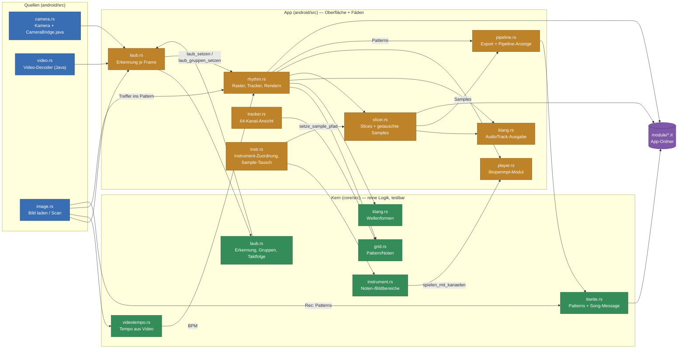

# Pipeline der JamCore-App (Stand 2026-10-21)

Welche Teile des Codes die App tatsächlich benutzt und wie sie zusammenhängen:
Bild/Video/Kamera → Laub → Rhythmus → `.it`, dazu der Audioweg und das Tempo.
Die Grafik ist farbig (Mermaid, `classDef`); dieselben Farben trägt der
Abschnitt **Pipeline** im Überblick-Tab.

## Grafik



Lesart: **blau** = Quelle (Kamera/Video/Bild), **grün** = Kernlogik
(`core/src`, ohne egui und ohne Android), **orange** = App-Schicht
(`android/src`, Oberfläche und Fäden), **violett** = Datei.

## Die Wege im Einzelnen

| Weg | Dateien | Was passiert |
|---|---|---|
| Bild/Video/Kamera | `android/src/camera.rs`, `video.rs` → `android/src/laub.rs` → `core/src/laub.rs` | Frames landen im Kamera-Puffer; der Laub-Tab erkennt Formen/Farben je Anzeigeframe. |
| Laub → Rhythmus | `android/src/laub.rs` → `rhythm.rs::laub_setzen`/`laub_gruppen_setzen`/`laub_taktgruppe_setzen` | Erkannte Takte/Gruppen werden Noten im Raster (`core/src/grid.rs`). |
| Rhythmus → Klang | `rhythm.rs` → `core/src/klang.rs` + `android/src/klang.rs` (AudioTrack) | Noten klingen über Wellenformen oder Slices; Kanalvergabe `core/src/kanal.rs`. |
| Slices / Sample-Tausch | `slicer.rs` (`setze_sample`, `sample_fuer_instrument`) ← `instr.rs` (`sample_tauschen`) | Ein Instrument spielt statt des Modul-Samples die Audiodatei; Ablage und Abspielweg liegen im Slicer. |
| Modul | `player.rs` (libopenmpt, `core/src/openmpt.rs`) ← `instr.rs::spielen_mit_kanaelen` | Notenbereiche des Instrument-Tabs steuern Modul-Instrumente; ein getauschtes Sample hat Vorrang. |
| Tempo | `image.rs` (Helligkeitsreihe) → `core/src/videotempo.rs` → `JamApp::tempo_setzen` | „Tempo aus Video" schreibt in **das eine** BPM der App. |
| Export | `pipeline.rs` (Export-Liste, Meta) → `core/src/itwrite.rs` | Slices als Samples, Raster als Patterns, Song-Message mit Datum/Quelle/Notiz; Datei in `module/`. |
| Aufnahme (`Rec`) | `image.rs` → `core/src/itwrite.rs` | Das laufende Raster wird fortlaufend als `.it` geschrieben (Patterns ergänzen/ersetzen). |
| Slicer-Export | `slicer.rs` → `core/src/itwrite.rs` | Slices als Samples; danach schreibt `Rec` Patterns in dieselbe Datei. |

## Song-Message und Order

- `core/src/itwrite.rs` schreibt die IT-Song-Message (Special-Bit 0, MsgLgth
  `0x36`, MsgOffset `0x38`) mit **einer Zeile je Pattern**:
  `Pattern 1: 2026-10-21, quelle=bild:klein_Quebec.jpg, notiz=…`, danach
  optional ein `Notizen:`-Block. Zeilen sind längenpräfixiert (max. 255 Bytes)
  und mit CR getrennt, UTF-8.
- Die Order-Liste im Kopf (`0x00C0`, `OrdNum` Bytes) ist `0, 1, …,
  Patterns−1`. Der Export zeigt und loggt sie 1-basiert:
  `Order: 1 2 3 4 (4 Patterns)` bzw. `it: Order 1,2,3,4 (4 Patterns)`.
- Export ohne Meta ist byte-gleich zum bisherigen Writer (eigener Test in
  `core/src/itwrite.rs::export_ohne_meta_unveraendert`).

## Live-Markierung in der App

Der Abschnitt **Pipeline** im Überblick-Tab (`android/src/pipeline.rs`,
`pipeline::Live`) färbt die Stufe, die gerade arbeitet:

| Stufe | Gemessen an |
|---|---|
| Bild/Video/Kamera | Kameraframes ändern sich (letzte Sekunde) oder Video-Prüfung läuft |
| `laub.rs` | Laub-Tab offen **und** Kamera/Video liefern Bilder (dort rechnet `ui`) |
| `rhythm.rs` | Rhythmus-Tab offen (Rendern läuft dort; einen öffentlichen Render-Zustand gibt es im Panel nicht) |
| `itwrite.rs` / `.it` | Export gerade geschrieben (3 s Nachleuchten) |
| `Export: module/` | derselbe Export-Merker |

## Prüfen

```bash
nix-shell --run 'export RUSTC_WRAPPER= TMPDIR=/tmp/opencode; cargo test -p jamcore itwrite'
nix-shell --run 'export RUSTC_WRAPPER= TMPDIR=/tmp/opencode; bash android/build-apk.sh --abi x86_64'
```

Auf dem Gerät: Export im Überblick auslösen, danach
`adb logcat -d | grep -E "it: (Order|geschrieben)"` und die Datei aus
`Android/data/org.jamcore.app/files/module/` mit `od -c` prüfen (Kopf:
`IMPM`, Special-Bit, Order, Message).
